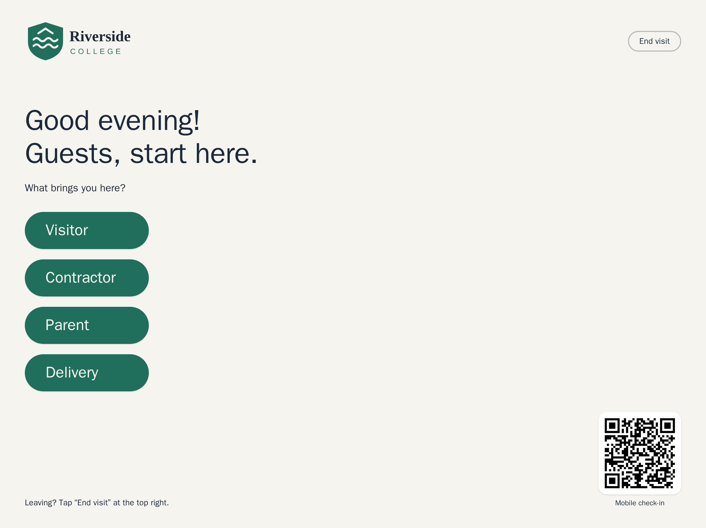
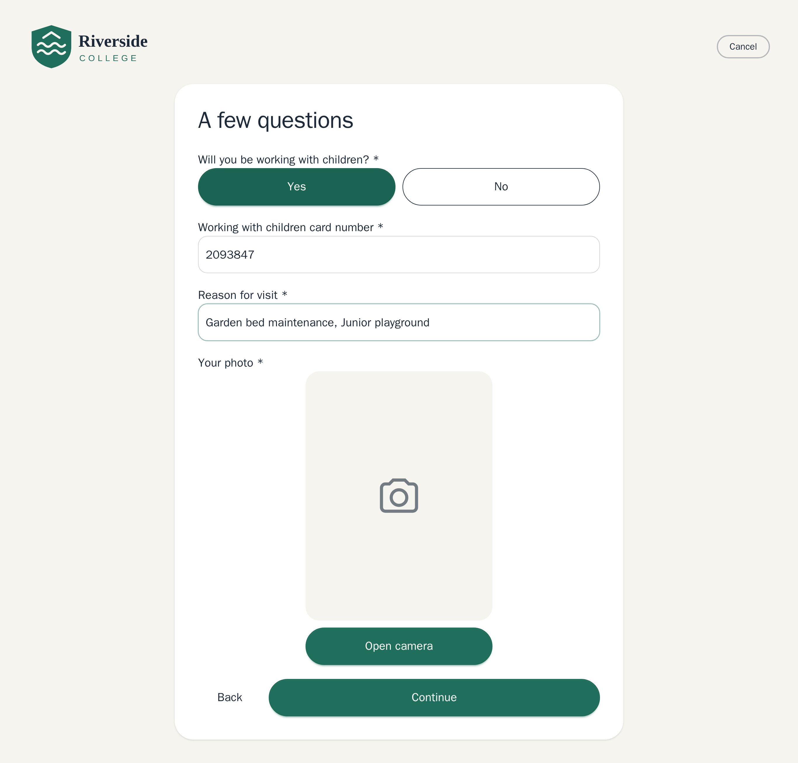
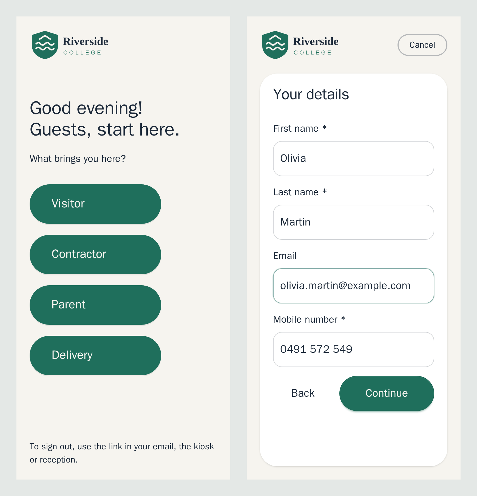
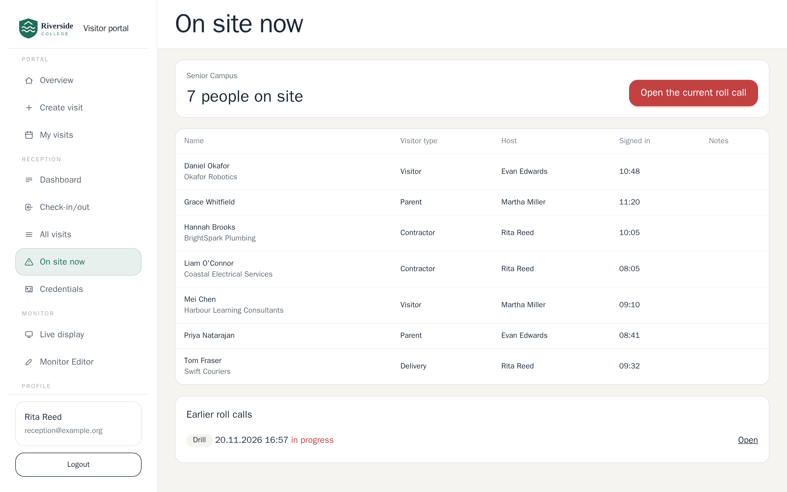
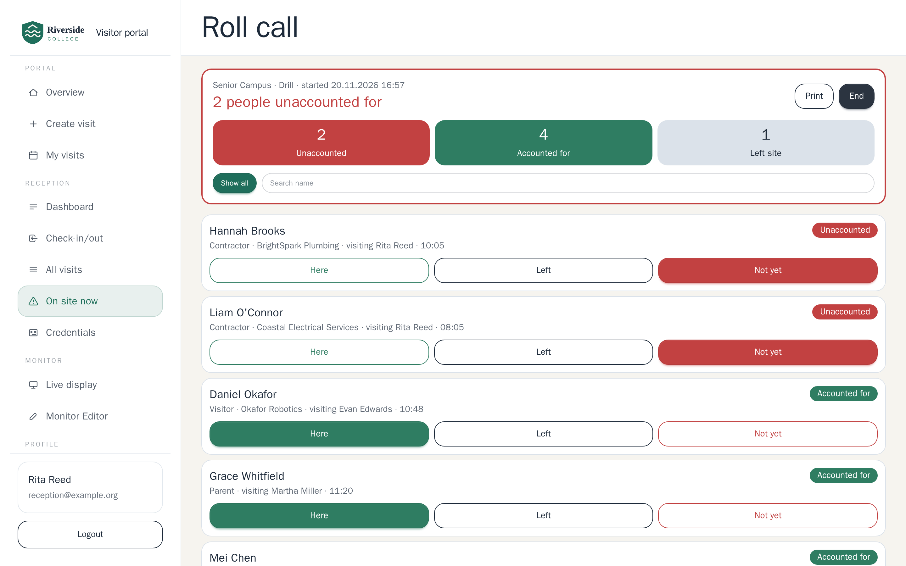
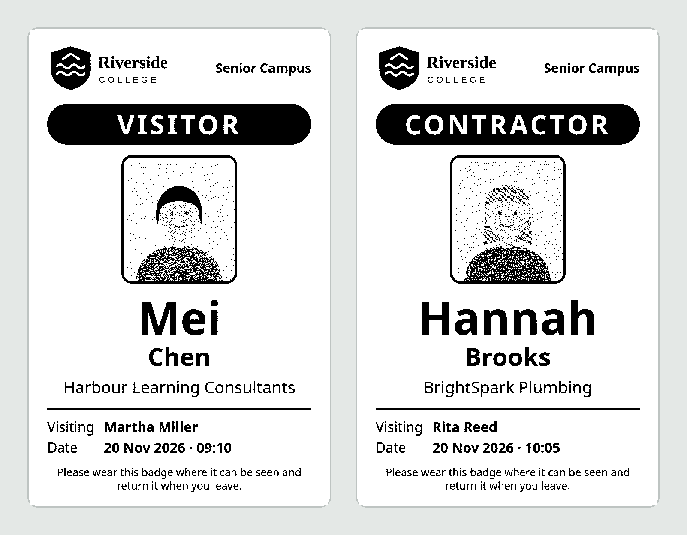
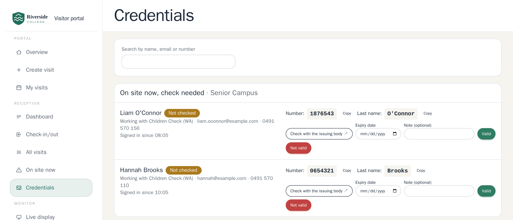
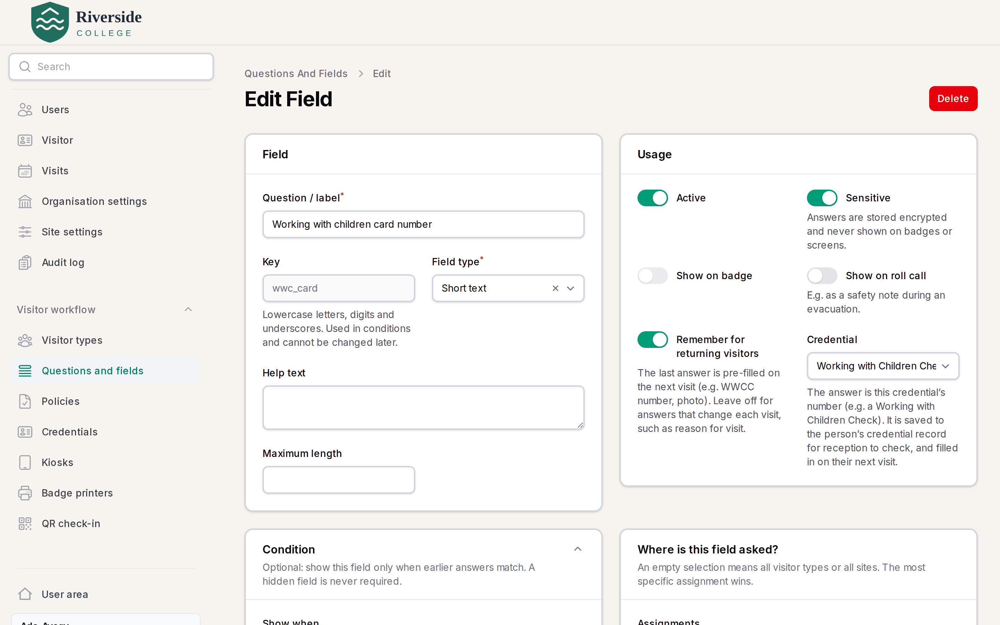
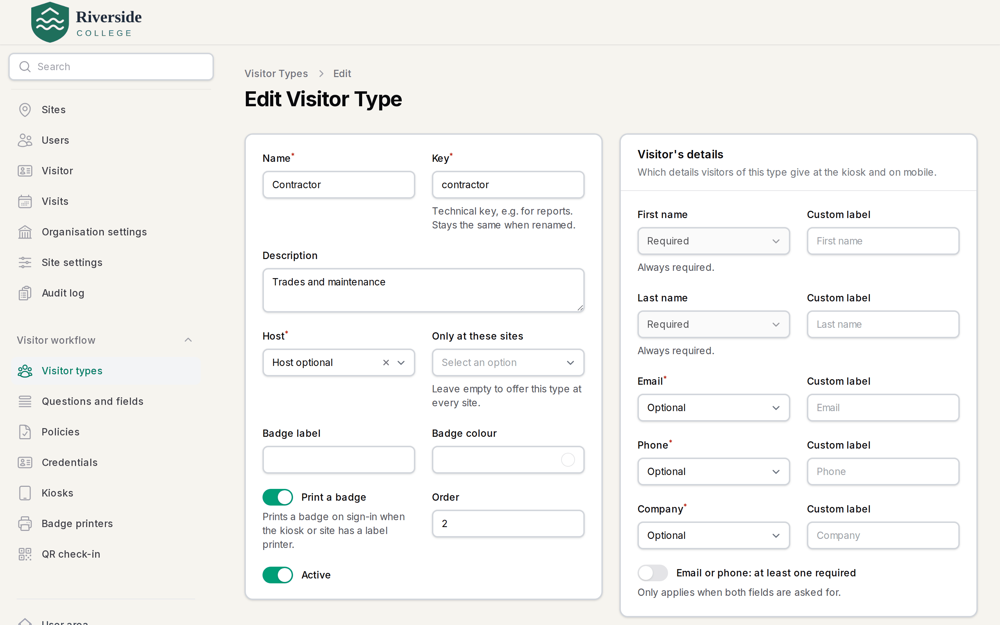

# Edu Visitor Portal

**Self-hosted visitor management for schools: kiosk and QR sign-in, child-safety checks, label badges and emergency roll calls.**

Edu Visitor Portal records who is on your campus, why they are there and whether they hold the
checks your child-safety policy requires. Visitors sign in at an iPad kiosk or on their own phone,
receive a printed badge and sign themselves out. Reception sees everyone on site at a glance, checks
Working with Children Check (WWCC) records and can run an emergency roll call from a phone.

It is built for schools and other multi-site organisations that want to keep visitor data on their
own infrastructure, with privacy, audit and data-retention controls designed in rather than added later.

Edu Visitor Portal by Simon Grant began as a fork of [VisitorPortal](https://github.com/P0etInc0de/VisitorPortal) by
Jonathan Läpple and the VisitorPortal contributors. Upstream's visit registration, reception
workflows, PDF badges, welcome monitor and role-based access control are all still here; the fork
adds the education-focused features below. Every change to an upstream file is listed in
[docs/fork/upstream-patches.md](docs/fork/upstream-patches.md).

The current release is **[v1.0.1](docs/releases/v1.0.1.md)**.

> The screenshots use a fictional school ("Riverside College") and fictional visitors.

## Contents

- [Features](#features)
- [Getting started](#getting-started)
- [Documentation](#documentation)
- [Security and privacy](#security-and-privacy)
- [Tech stack](#tech-stack)
- [Contributing](#contributing)
- [Credits](#credits)
- [Licence](#licence)

## Features

### Kiosk and QR sign-in

- **iPad kiosk** enrolled with a one-time setup code. The kiosk never signs in as a staff user, can
  be revoked instantly and clears itself after a configurable period of inactivity.
- **QR / mobile sign-in**: a per-site QR code (on the kiosk and on a printable A4 poster) lets a
  queue of visitors sign in on their own phones through the same workflow.
- **Configurable visitor types** (visitor, contractor, parent, delivery…), each with its own
  personal details, host requirement (required, optional or none) and badge setting.
- **Configurable questions**: 13 field types, including yes/no, dropdown, date, photo, signature and
  file upload, with show-when conditions, sensitive (encrypted) answers and per-site assignments.
- **Policies** with versioned wording; the exact version each visitor accepted is recorded.
- **Photo and signature capture** in the browser, including iPad home-screen web apps, with an
  adjustable camera zoom (head and shoulders by default).
- **Returning visitors** are recognised by email or mobile number. Saved details are shown masked
  and can only be reused or changed after a 6-digit code sent by email.
- **Self sign-out** at the kiosk, on the phone that signed in or through a one-time emailed link,
  plus per-site **automatic sign-out** at a set time.

<p align="center">
  
  
</p>
<p align="center">
  
</p>

### Reception and emergency roll call

- **On site now**: everyone signed in at a site, with visitor type, host and sign-in time,
  refreshed automatically and limited to the sites a user may see.
- **Emergency roll calls and drills**: one tap takes a snapshot of everyone on site. Wardens mark
  people *Here*, *Left* or *Not yet* from a phone, add late arrivals or people who never signed in,
  and can print a paper copy. Starts, marks and ends are audited.
- **Emergency SMS and email broadcasts** (through MessagePort) to the people on site, with
  delivery receipts. A broadcast resumes where it stopped if the server restarts.
- Upstream's reception dashboard, check-in/out board, visit booking and welcome monitor.





### Badges and credentials

- **Label badge printing** straight from the server to network label printers (Brother QL raster
  over TCP port 9100), so no print dialog appears on the kiosk or phone. Badges show the logo, site,
  a visitor-type pill, photo, name, company, host and time. A printing failure never undoes a sign-in.
- **Visitor credentials** such as a Working with Children Check: the number given at sign-in (or
  imported from CSV) becomes a record that reception checks on the issuing body's own validation
  page, then marks *Valid* or *Not valid* with an expiry date. Numbers are encrypted at rest,
  every check is audited, and a review list shows records that are unchecked, expired or due
  for a re-check.

<p align="center">
  
</p>



### Administration, identity and notifications

- **Admin dashboard**: a welcome panel, live tiles (on site now, today, compliance, safety),
  trend charts and system health.
- **Scheduled reports** (weekly, monthly and after each roll call) emailed as PDF with CSV to
  recipient groups per site, plus CSV exports of visits and visitors.
- **Organisation and site settings** in the admin panel: name, contact details, logos, brand
  colours (kept readable with contrast rules), visitor wording, language and retention periods.
  Sites inherit the organisation's settings and can override them.
- **Multi-site**: visits, kiosks, QR codes, printers and reception views are scoped by site.
- **Microsoft Entra ID**: staff sign-in through OpenID Connect, and optional **host sync** that keeps
  each site's hosts in step with Entra groups.
- **Host alerts** by email (including Microsoft 365 mail through Microsoft Graph, without SMTP
  passwords) and in **Microsoft Teams**, as an activity-feed alert or a chat message from a bot.
- **Immutable visitor log**: attended visits become view-only, edits to visitor details are
  audited, and the database protects the audit log from changes.
- **Audit log** of configuration changes, sign-ins, sign-outs, roll calls and credential checks.
- **Data retention**: visits, evidence files (photos and signatures), roll calls and audit events
  are purged on schedules you set, and a legal hold keeps a visit's evidence for as long as needed.
- **Multi-factor authentication** for every password sign-in; Microsoft sign-in relies on the
  identity provider's own Conditional Access.
- Upstream's roles and permissions and light/dark themes.





## Getting started

Edu Visitor Portal runs in Docker. For a local development stack:

```bash
cp backend/.env.example backend/.env
docker compose up -d --build
docker compose exec web composer install
docker compose exec web php artisan key:generate
docker compose exec web php artisan migrate:fresh --seed
```

Then open [http://localhost:8080](http://localhost:8080). The seeders create demo accounts (for
example `admin@example.org` and `reception@example.org`, password `ChangeMe-42!`); demo seeding is
blocked in production. Never use demo data or credentials in a real deployment.

For production, use the published container image and follow the deployment guide below:

```text
ghcr.io/alta1college/eduvisitorportal:v1.0.1
```

If pulling the image is refused (the package is not yet public), build the same image from the
release's source: `docker build --pull --target app -f docker/app/Dockerfile -t eduvisitorportal:v1.0.1 .`
and set `VISITORPORTAL_IMAGE=eduvisitorportal:v1.0.1`.

English is the default language (German, French and Czech are also available) and the default
timezone is UTC; set `APP_TIMEZONE` for your region before the first start.

| Guide | What it covers |
| --- | --- |
| [Setup](docs/setup.md) | Development and demo setup in detail |
| [Production deployment](docs/fork/production-deployment.md) | A single Linux server with Docker, Caddy and Let's Encrypt |
| [Deployment](docs/deployment.md) | Upstream's production guide, reverse proxy and updates |
| [Go-live checklist](docs/go-live-checklist.md) | What to review before handling real visitor data |
| [Configuration](docs/configuration.md) | Environment settings |
| [Kiosk](docs/fork/phase-5-kiosk.md) and [QR sign-in](docs/fork/phase-6-qr-mobile.md) | Enrolling kiosks, QR codes and posters, customising the sign-in |
| [Badge printing](docs/fork/phase-8-badge-printing.md) | Label printers and the badge layout |
| [Emergency operations](docs/fork/phase-9-emergency.md) | On site now, roll calls and automatic sign-out |
| [Credentials](docs/fork/credentials.md) | Working with Children Checks and similar records |
| [Entra hosts and staff SSO](docs/fork/phase-10-entra-hosts-and-deployment.md) | Host sync from Entra groups and Microsoft sign-in |
| [Microsoft Graph mail](docs/fork/microsoft-graph-mail.md) | Sending mail through Microsoft 365 with OAuth |
| [Teams notifications](docs/fork/teams-notifications.md) | Host alerts in Microsoft Teams |
| [Emergency broadcasts](docs/fork/emergency-broadcast.md) | SMS and email messages to everyone on site |
| [Admin dashboard](docs/fork/admin-dashboard.md) | Dashboard tiles, charts, scheduled reports and exports |
| [Release notes](docs/releases/) and [release artifacts](docs/release-artifacts.md) | What is in each release and how it is published |

## Documentation

- Operations: [monitoring and operations](docs/operations.md), [queue](docs/queue.md),
  [scheduler](docs/scheduler.md), [welcome monitor](docs/welcome_monitor.md)
- Access: [roles and permissions](docs/roles.md), [single sign-on](docs/sso.md)
- Fork design: [architecture assessment](docs/fork/phase-0-1-assessment.md),
  [organisation configuration](docs/fork/phase-2-organisation-configuration.md),
  [visitor workflow](docs/fork/phase-3-visitor-workflow.md),
  [public boundary](docs/fork/phase-4-public-boundary.md),
  [returning visitors and sign-out](docs/fork/phase-7-returning-signout.md)
- Upstream: [upstream patches](docs/fork/upstream-patches.md), [upstream sync](docs/fork/upstream-sync.md),
  [known limitations](docs/known-limitations.md)

## Security and privacy

Edu Visitor Portal processes personal information about visitors, including photos and child-safety
check numbers. Before using it with real data, review your legal obligations, retention periods,
access control, backups and hosting.

- [SECURITY.md](SECURITY.md): how to report a vulnerability (not through public issues)
- [PRIVACY.md](PRIVACY.md) and the [data protection notice template](docs/data-protection-notice-template.md)
- [Security validation](docs/fork/phase-11-security-validation.md): review findings, fixes and open items
- [Security hardening](docs/security-hardening.md)

The anonymous visitor pages (kiosk, QR and sign-out links) are a separate security boundary with
opaque tokens, rate limits and audit logging; see [the public boundary](docs/fork/phase-4-public-boundary.md).

## Tech stack

PHP 8.4, Laravel 13, Livewire 4, Filament 5, MariaDB 11.4, Tailwind CSS with daisyUI, Gotenberg for
PDF and badge rendering, Docker Compose, and PHPUnit and Playwright tests. CI runs the tests on
MariaDB, a code style check, a licence header check and a single sign-on end-to-end test. Contributors should read
[CLAUDE.md](CLAUDE.md) and [CONTRIBUTING.md](CONTRIBUTING.md) for the project rules.

## Contributing

Contributions are welcome. Please read [CONTRIBUTING.md](CONTRIBUTING.md) before opening a larger
pull request. Organisation-specific values (sites, branding, WWCC rules, printers) belong in
settings, never in code.

## Credits

Edu Visitor Portal is developed by [Simon Grant](https://github.com/SimonAlta1).

Based on [VisitorPortal](https://github.com/P0etInc0de/VisitorPortal) by Jonathan Läpple and
contributors. Many thanks to the original team (Jonathan Läpple, Jannik Schabel, Jan Wangerin,
Lena Berger and Peter Claaß) and to everyone who has contributed to VisitorPortal: their work is the
foundation this project builds on.

## Licence

Copyright (C) 2026 Jonathan Läpple and VisitorPortal contributors (upstream VisitorPortal).
Copyright (C) 2026 Simon Grant (Edu Visitor Portal additions and changes).

Edu Visitor Portal is free software, licensed under the GNU General Public License v3.0 or later
(GPL-3.0-or-later). See [LICENSE](LICENSE).
